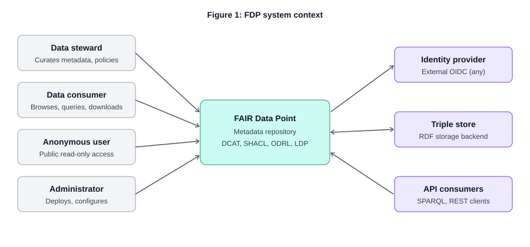
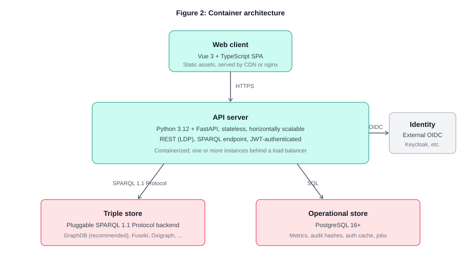
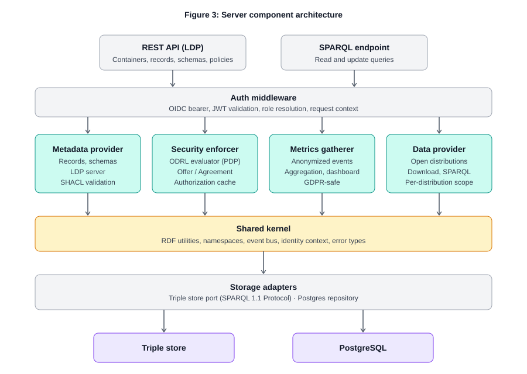
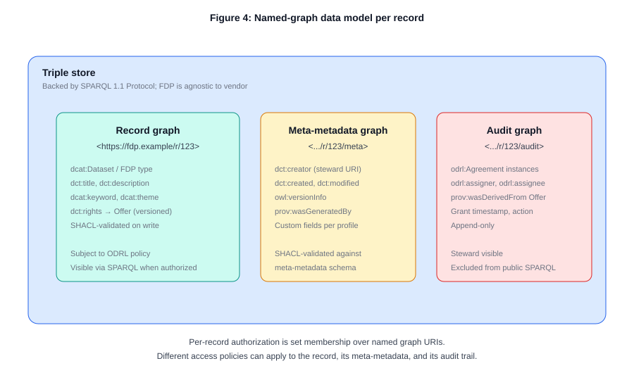
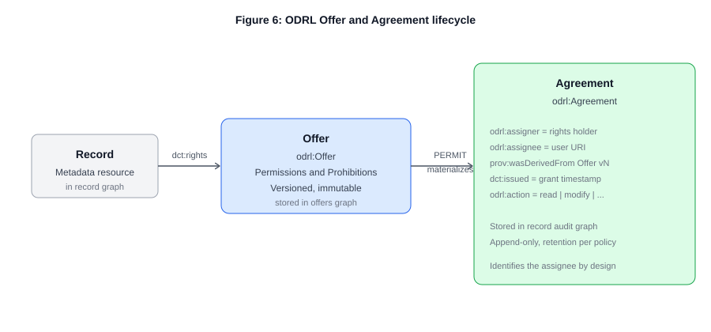
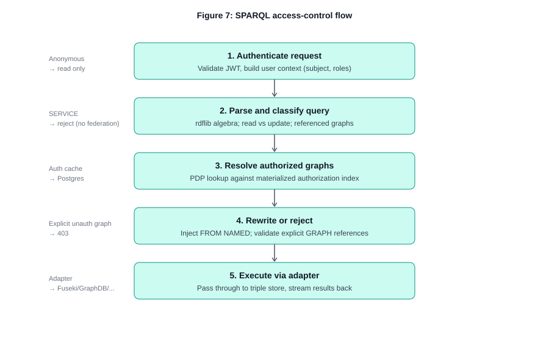
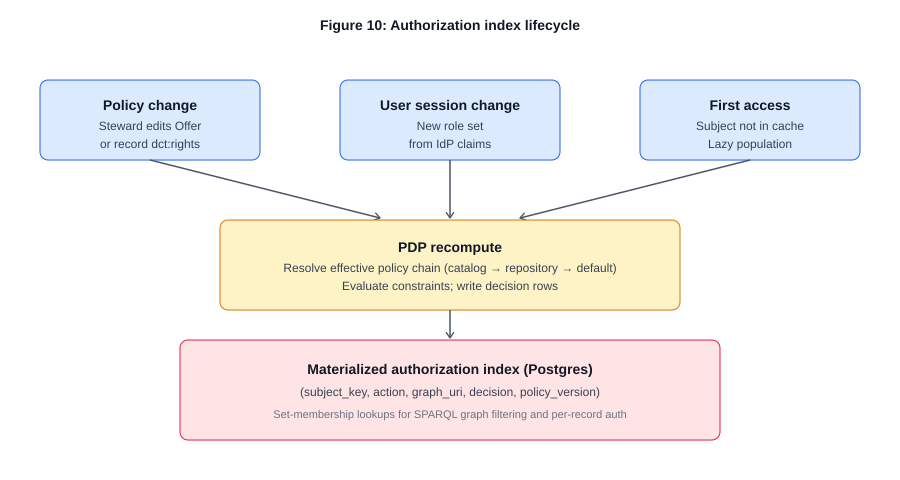
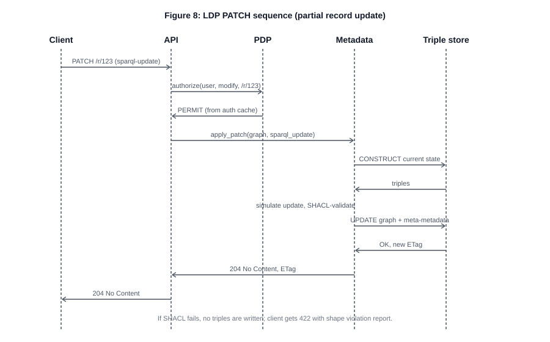
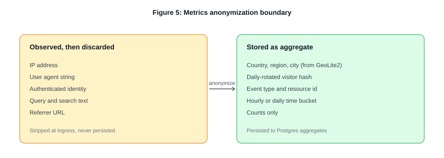
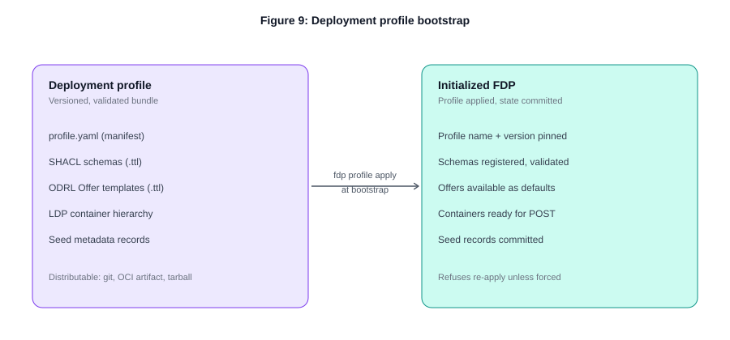

# Architecture

This page summarises the FDPneo server architecture. The full, authoritative design is the 15-section architecture document in the server repository, [`docs/architecture/README.md`](https://github.com/FAIRDataTeam/fdpneo-server/blob/main/docs/architecture/README.md), complemented by the [architecture decision records](../development/adrs.md) and an eight-part [developer guide](https://github.com/FAIRDataTeam/fdpneo-server/tree/main/docs/dev-docs). When this summary and those documents disagree, they win.

## System context

FDPneo serves four user roles (anonymous users, data consumers, data stewards and administrators, see [Users and roles](users-and-roles.md)) against three external systems: an OIDC identity provider, a triple store reached over SPARQL 1.1 Protocol, and third-party API consumers that authenticate with the same bearer tokens the web client uses.

## Containers

The web client is a static Vue 3 single-page application. The API server is a Python/FastAPI process exposing a REST/LDP API and a SPARQL endpoint. The triple store holds the knowledge graph; PostgreSQL holds operational state. The two stores are kept strictly apart: RDF never goes to PostgreSQL and operational state never goes to the triple store.

## Server components

The server is a modular monolith with hard internal boundaries. Bounded contexts for `identity`, `metadata`, `policy`, `access`, `data`, `metrics` and `storage`, plus a `shared` kernel, talk through explicit interfaces rather than by reaching into each other. Both HTTP entry points pass through the same authentication middleware, which validates the JWT against the identity provider's published keys and resolves the token's role claims into a frozen set of role IRIs used in policy evaluation.

## Data model: one named graph per record

Every metadata record corresponds to exactly one named graph, and the graph IRI is the record's identifier. Two sibling graphs accompany it: a meta-metadata graph (`…/meta`) holding provenance (`dct:creator`, `dct:created`, `dct:modified`, `owl:versionInfo`, `prov:wasGeneratedBy`), written only by the server, and an append-only audit graph (`…/audit`) holding the ODRL Agreements issued against the record's Offer.

This invariant has three consequences. Per-record access control reduces to set membership over named-graph IRIs. LDP `PATCH` maps directly onto SPARQL Update scoped to the record's graph. Replacing or deleting a record is a graph-level operation. The trade-off is that records cannot share triples, which suits the tree-shaped FDP hierarchy.

Meta-metadata graphs, audit graphs and the resource-definition records of the typed-resource registry are internal: a single shared set of reserved graph-IRI patterns excludes them from the public SPARQL dataset and from any non-admin authorization set.

## Identity and authentication

The client uses the OIDC Authorization Code flow with PKCE directly against the identity provider and sends the access token as a bearer on every API call. API consumers use the same flow or, for service-to-service use, Client Credentials; the server sees only a JWT either way. A user is identified by the token's `sub` claim namespaced by the issuer URL; display name and e-mail are read from the token on each request and never persisted.

## ODRL policy model

Every authorization decision goes through the policy module, which has two engines (ADR-0027). In the default **open** mode it answers without any policy: read is permitted to everyone, and modify, delete and distribute to the configured writer roles. In **odrl** mode it runs the full model described in this section. The mode is the runtime setting `access.control`, seeded from `FDP_ACCESS_CONTROL_MODE`, and the enforcement points are unaware of it.

Access conditions are expressed in a documented subset of W3C ODRL. The profile supports `odrl:Offer` and `odrl:Agreement`, rules of type `odrl:Permission` and `odrl:Prohibition` (no Duties), the actions `read`, `modify`, `delete` and `distribute`, and constraints on party identity, role membership, group membership and time windows. Purpose, spatial, payment and count constraints are deliberately excluded.

Offers are versioned and immutable. When a steward edits access conditions, a new Offer version is created and the record's `dct:rights` points to it; previous versions are preserved. When the policy decision point returns `PERMIT`, it materialises an `odrl:Agreement` that references the exact Offer version in force, the assignee, the action and the grant time, and stores it in the record's audit graph.

A record without `dct:rights` inherits its policy from its parent container (dataset from catalog, catalog from repository, repository from the system default), resolved by walking up on lookup. Conflicts default to deny wins; a policy may override this with `odrl:conflict`.

## SPARQL endpoint with access control

The `/sparql` endpoint is not a passthrough. Every query is parsed into an algebra tree, classified as a read or an update, and rewritten before dispatch. For reads, the rewriter injects `FROM NAMED` clauses for every graph in the user's authorized read set, so aggregates, `OPTIONAL` and nested queries all behave correctly because the engine never sees unauthorized graphs. Updates from anonymous users are rejected, update targets are validated against the authorized modify set, and `SERVICE` clauses are rejected because federation is out of scope.

A materialised authorization index in PostgreSQL, keyed by subject, action and graph IRI, avoids evaluating policies for every pair on every query. It is recomputed lazily on first access and invalidated when a policy, a record's policy reference or a user's roles change; tightening is applied synchronously, loosening eventually.

A query that explicitly names a graph the user cannot see gets a 403. A query that names no graphs is silently constrained to the authorized set, so the user cannot distinguish "does not exist" from "exists but hidden".

## Linked Data Platform

FDPneo implements W3C LDP fully, including containment, content negotiation and `PATCH` with `application/sparql-update` for partial updates. Records are created with `POST` to a container or `PUT` to an IRI, start in publication state `DRAFT` unless the request carries `Prefer: publication-state=PUBLISHED`, and require `If-Match` with the current ETag on updates and deletes (optimistic concurrency). Property-level access control within a record is out of scope.

## Metrics and privacy

The metrics pipeline strips personally identifying data at ingress. Visitors are counted with a daily-rotated hash, query text is never stored, no analytics cookies are set, and raw rows are rolled up to hourly and daily aggregates and pruned on a fixed schedule. The dashboard shows per-record and per-schema views and downloads, SPARQL query counts and latencies, unique visitors per day, time-of-day patterns, top resource types and, when a GeoIP database is configured, geography.

## Deployment profiles

A deployment profile is a bundle with a manifest (`profile.yaml`), SHACL schemas, ODRL Offer templates, a container hierarchy and seed records. At first start, an uninitialised FDPneo validates the configured profile and applies it in dependency order; if validation fails it refuses to start. The profile is applied exactly once per deployment lifetime; a different profile requires a forced re-bootstrap from a clean slate. Resource definitions seeded by the profile are runtime-mutable afterwards through the admin API. A running deployment's state can be packaged into a new profile with `fdp profile export`.

## Client application

The client is a Vue 3 application in strict TypeScript, built with Vite, using Pinia for state, TanStack Query for server cache, PrimeVue components, Monaco for the code editors, and request/response types generated from the server's OpenAPI specification. It is stateless across reloads; all persistent state lives on the server.

## Further reading

- [Architecture document](https://github.com/FAIRDataTeam/fdpneo-server/blob/main/docs/architecture/README.md) (server repository)
- [Developer documentation](https://github.com/FAIRDataTeam/fdpneo-server/tree/main/docs/dev-docs): system context, application architecture, code organisation, request lifecycle, key processes, data model, contributing, backup and restore
- [Agent consumption vision](https://github.com/FAIRDataTeam/fdpneo-server/blob/main/docs/architecture/agent-consumption-vision.md)
- [Architecture decision records](../development/adrs.md)
