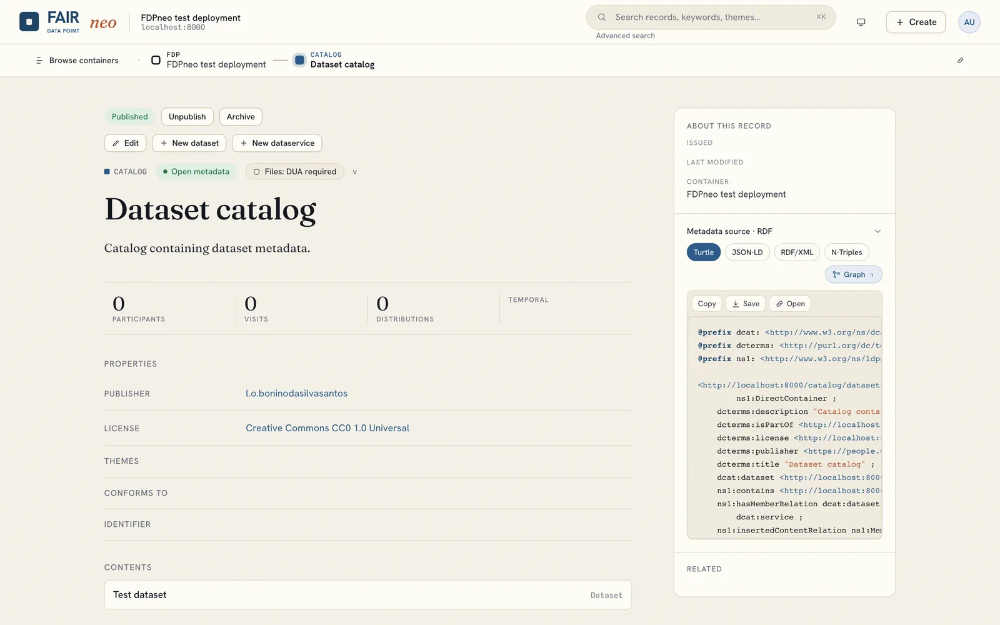
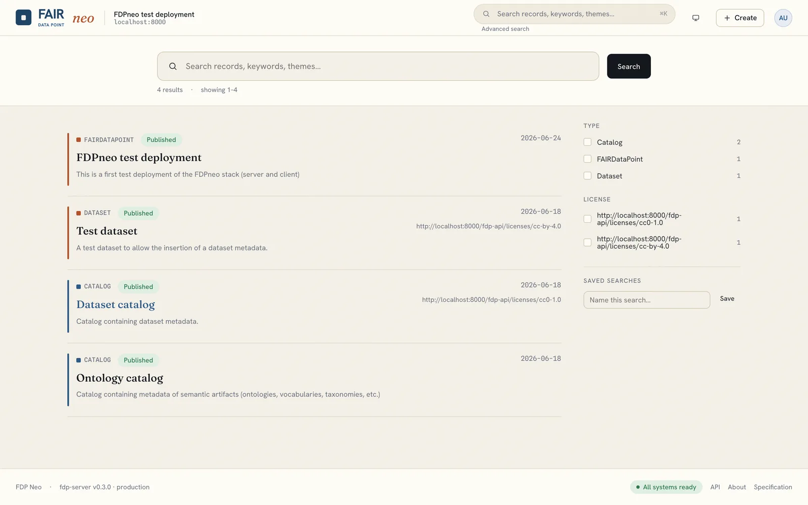
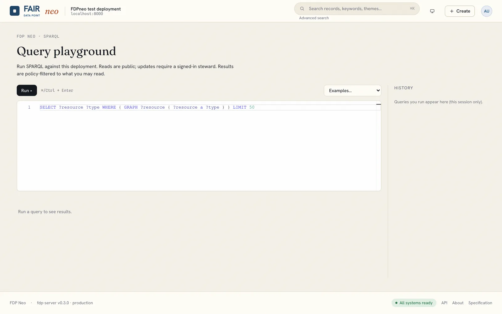

# Browsing, search and SPARQL

Everyone, signed in or not, can explore the metadata in three ways: by browsing the catalog hierarchy, by searching, and by querying with SPARQL. Anonymous users see only published records; signed-in users additionally see what their policies allow.

## Browsing

The home page shows the catalog tree and record cards. Click a record to open its detail page: its properties, links to related records, breadcrumbs to the parent catalog, and (for stewards and administrators) its publication state and the edit controls.



Every record is Linked Data. Its URL is its identifier, and the detail page offers the record's RDF in several serialisations (Turtle, JSON-LD, RDF/XML, N-Triples). A program fetching the same URL with an `Accept` header for RDF receives the data directly; see [API usage](../api/index.md).

## Search

The search box in the top bar, and the Search page, take a free-text query and offer **facets** (resource type, license and others) built from the live index. Results respect policy and publication state, so anonymous users only find published records.



Signed-in users can **save a search** and re-run it later. Administrators can mark a saved search as **shared** so that everyone sees it.

Search is backed by the PostgreSQL index. If search returns nothing while browsing works, the index may be empty; an administrator rebuilds it with `fdp search reindex`.

## SPARQL playground

The SPARQL page runs SPARQL 1.1 queries directly against the metadata, with a query history and tabular results.



A few things to know about the endpoint:

- It is served by FDPneo at `/fdp-api/sparql`, not by the triple store. Every query is rewritten to the set of named graphs you are allowed to read, so results are exactly what you could see by browsing. Aggregates and `OPTIONAL` behave correctly because the engine only sees authorised graphs.
- Internal graphs (meta-metadata, audit trails, resource definitions) are never part of the public dataset.
- `SERVICE` clauses are rejected; FDPneo does not federate queries.
- Updates require authentication and are checked per target graph; anonymous users can only read.

A starting query that lists published datasets with their titles:

```sparql
PREFIX dcat: <http://www.w3.org/ns/dcat#>
PREFIX dct:  <http://purl.org/dc/terms/>
SELECT ?dataset ?title WHERE {
  ?dataset a dcat:Dataset ;
           dct:title ?title .
} LIMIT 50
```
