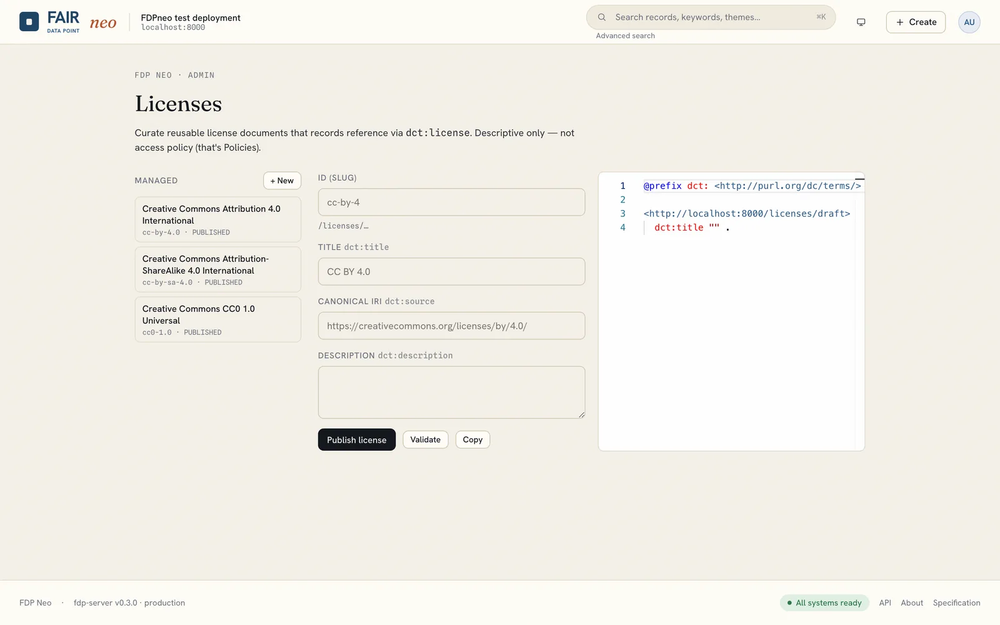

# Licenses

Licenses are reusable documents that records reference through `dct:license`, for example CC BY 4.0 or CC0. Curating them once means stewards pick from a consistent list instead of pasting IRIs, and consumers (and agents) can find out under which terms data may be reused.

Open **avatar, Licenses** as an administrator.

Each license has a **title**, an optional canonical **IRI** (`dct:source`, for example `https://creativecommons.org/licenses/by/4.0/`) and a **description**. Save and publish it; published licenses appear in the record form's *License* picker. A steward may still paste a license IRI directly when a record needs one that is not in the list.

Licenses are descriptive only. They say nothing about who may read or edit the metadata record; that is the job of an [access policy](policies.md).
