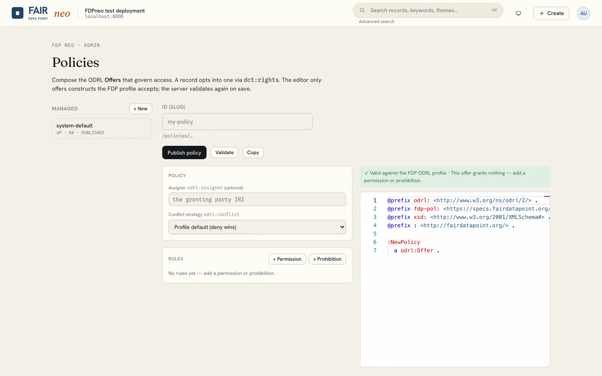

# Access policies (ODRL)

FDPneo can control access to records with W3C ODRL **Offers**. A record opts into a policy through `dct:rights`, and in ODRL mode the server's policy decision point enforces it on every request, whether it comes from the web client, the API or the SPARQL endpoint.

## Access-control mode

Access control has two modes, and the default is **open** (ADR-0027).

| Mode | Read | Create, edit, delete | Policies |
|---|---|---|---|
| `open` (default) | Everyone, anonymous visitors included, can read every published record. | Users holding one of the *writer roles* (`admin` and `steward` by default). | Stored, validated and served, but not consulted. |
| `odrl` | Decided by the record's ODRL policy. | Decided by the record's ODRL policy. | Enforced, with inheritance, versioning and the audit trail described below. |

Publication state applies in both modes: a draft stays hidden from anyone who may not curate it. Admin-only pages (schemas, resource types, users, settings) are gated by the `admin` role in both modes.

The deployment default comes from `FDP_ACCESS_CONTROL_MODE` (`open` or `odrl`, see [Configuration](../deployment/configuration.md#access-control)). An administrator can switch at any time, without a restart, under **avatar, Settings, Access control**, which also edits the writer roles. Resetting the setting returns to the deployment default. A switch rebuilds the decision cache and the search index's visibility flags in the background.

While the deployment is in open mode, the Policies page shows a notice that policies are stored but not enforced. You can still author and publish policies and attach them to records, so they are in place when you switch to ODRL mode.

!!! warning "Upgrading a deployment that relies on policies"
    Open mode became the default in the server release after 0.17.0. A deployment that relies on ODRL policies must set `FDP_ACCESS_CONTROL_MODE=odrl`, or switch the setting, when it upgrades. Otherwise every published record becomes publicly readable.

## Managing policies

Open the **Policies** tab in the header as an administrator.

## The FDPneo ODRL profile

Policies must stay within a documented subset of ODRL, which keeps the evaluator simple and the editor coherent:

| Element | Supported |
|---|---|
| Policy types | `odrl:Offer` (authored) and `odrl:Agreement` (materialised by the server on grant) |
| Rules | `odrl:Permission` and `odrl:Prohibition`; no Duties |
| Actions | `odrl:read`, `odrl:modify`, `odrl:delete`, `odrl:distribute` |
| Constraints | party identity, role membership, group or organisation membership, time windows |
| Conflict strategy | deny wins by default; `odrl:conflict` may override |

Purpose, spatial, payment and count constraints are not part of the profile.

## The guided composer

The composer builds an Offer from the profile only, so it cannot produce an out-of-profile policy:

1. Pick an **action** (read, modify, delete, distribute).
2. Add **permissions** and **prohibitions**.
3. Attach **constraints**: a role (for example `steward`), a specific party, a group, or a time window.
4. Choose the **conflict strategy**.

A live Turtle preview and inline validation show exactly what will be stored, and **Validate** runs the server's profile check. Save, publish or delete managed policies; published policies appear in the record form's *Access policy* picker.

## Inheritance and the system default

A record without `dct:rights` inherits the policy of its parent: a Dataset from its Catalog, a Catalog from the Repository, and the Repository from the system default. Inheritance is resolved by walking up at lookup time, so every record's effective policy can be discovered by following the chain.

The system ships a default Offer, `system-default`, that grants public read and steward modify. In ODRL mode it is the baseline until you author your own. Open mode gives the same result, public read and writer-role modify, without evaluating any policy.

## Versioning and audit

Offers are versioned and immutable. Editing access conditions creates a new version and points the record at it; earlier versions are preserved. When the server permits an access, it materialises an Agreement that references the exact Offer version in force, the assignee and the action, and stores it in the record's audit graph. Audit graphs are visible to the record's owner and to administrators, never to anonymous users.

## Policies and licenses are different things

A policy governs who may do what with the metadata record. A [license](licenses.md) describes the terms under which the described data may be reused. Records usually reference both.
