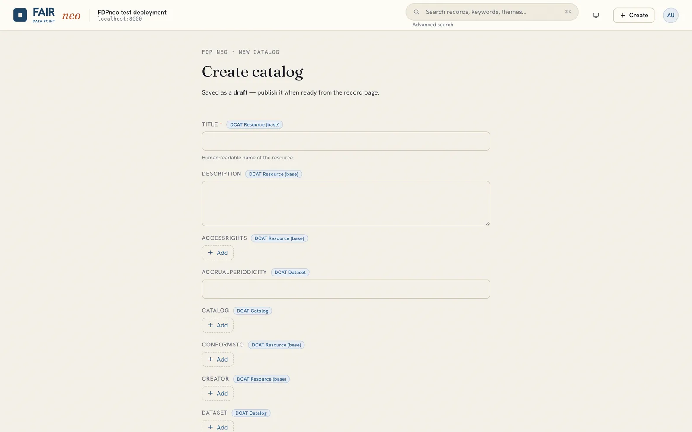
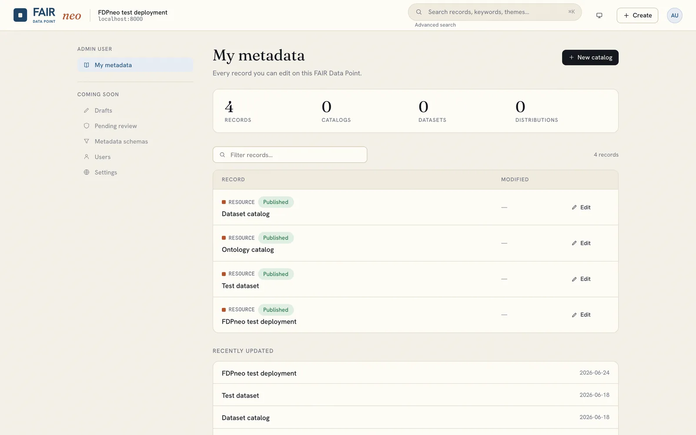

# Publishing metadata

Stewards and administrators create and maintain records. FDP metadata follows DCAT: a **Catalog** contains **Datasets**, which contain **Distributions**, and a deployment may define further types (see [Schemas and resource types](schemas.md)). Records are created top-down, each inside its parent.

## Create a record

1. Click **Create** in the top bar to make a top-level Catalog, or open an existing record and use its **new child** link (for example a Dataset under a Catalog).
2. Fill in the form. The fields come from the deployment's SHACL schema for that type (title, description, publisher, keywords, and so on). Required fields are marked, and the form validates against the schema before saving.
3. Two pickers reference managed documents:
    - **Access policy** (`dct:rights`): choose a published ODRL policy that governs who may read, modify or delete the record. See [Access policies](policies.md). A record without one inherits the policy of its parent.
    - **License** (`dct:license`): choose a published license or paste an IRI. See [Licenses](licenses.md).
4. **Save.** By default the record is created as a **draft**. Tick **Publish immediately** next to the create button to make it publicly visible in one step.

## Publication lifecycle

A record moves through **draft**, **published** and **archived**. Open the record and use the state control (as its owner or an administrator) to publish it. Only published records are visible to anonymous users and offered for selection elsewhere in the application. A draft is visible to its owner and to administrators.

The same lifecycle applies to records created through the API: a create returns `201` with an `FDP-Metadata-State` header naming the birth state, and `Prefer: publication-state=PUBLISHED` on the creating request publishes immediately. See [API usage](../api/index.md).

## Edit, replace, delete

From a record's detail page, its owner or an administrator can edit it in the same schema-driven form, or delete it. Every write updates the record's meta-metadata (creator, created, modified, version) automatically; this provenance is maintained by the server and is not editable.

## My data

The **Dashboard** ("My data") under the avatar menu lists the records you own or may edit, with their publication state, and a *Recently updated* section, so you have your working set at a glance.

