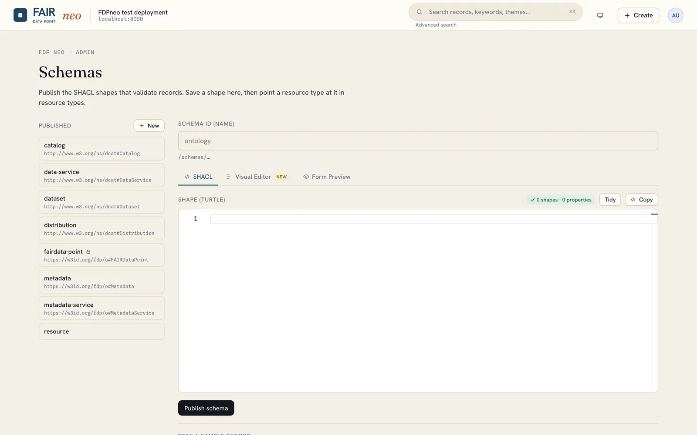
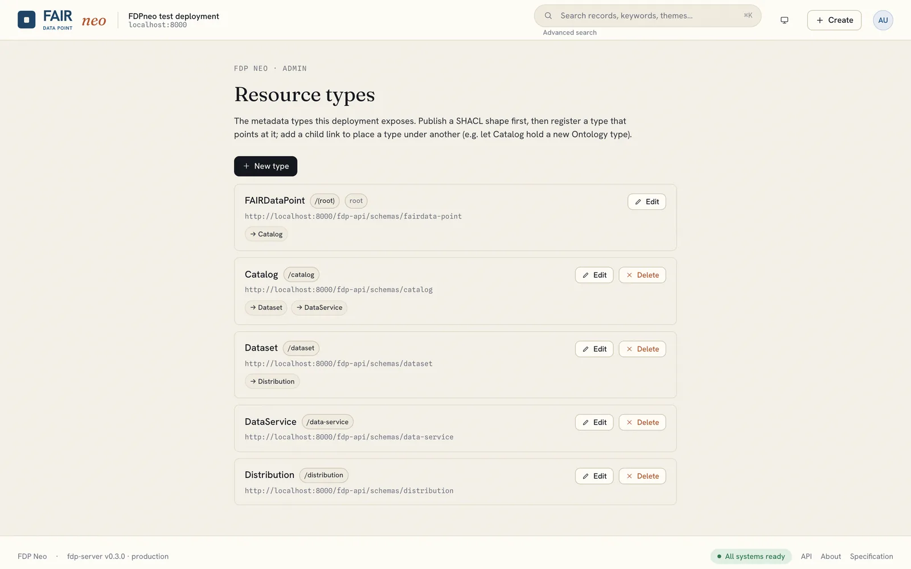

# Schemas and resource types

Administrators define what can be described in an FDPneo and how. Two concepts work together:

- A **schema** is a SHACL shape that says which properties a record of a given type has, which are required, and what values are valid. Forms, validation and the record detail view are all driven by it.
- A **resource type** registers a type in the deployment (its name, the shape it is validated against, and which child types it may contain). Registering a type makes it appear across the application, in browsing and in the create forms, without a rebuild or restart.

Describing a type and exposing it are kept separate on purpose: publishing a shape never automatically exposes a type, so draft shapes and reusable building blocks (`sh:node`) do not leak into the URL space.

## Schemas

Open the **Schemas** tab in the header (administrators only).

- **List, author and publish** shapes. Each shape has a slug that becomes its stable IRI under `/fdp-api/schemas/`, and saving an existing shape creates a new version, so records keep pointing at the version they were validated against. The shapes of the bundled profile are marked as protected.
- **Validate** a sample record against a saved shape before relying on it.
- The **Visual Editor** lets you author a shape as the form it will produce. A palette of widgets (text field, text area, rich text, URI, autocomplete, and more) is dragged or clicked onto a form canvas organised in groups; the inspector on the right holds the schema settings (name, description, shape IRI, target class) and, per field, the property path, datatype, cardinality and other constraints. Nested shapes can be added for structured values. The **SHACL Code** tab shows and edits the same shape as Turtle, the **Form Preview** tab shows the form a steward will fill in, and the **Graph** button opens a graph view of the shape. The three views round-trip. The editor is functionally inspired by [ProjectOak](https://github.com/luizbonino/ProjectOak).

The bundled default profile provides the standard FDP/DCAT shapes (Repository, Catalog, Dataset, DataService, Distribution). A community profile can replace or extend them with, for example, biobank, sample, patient-registry or publication types while keeping DCAT compatibility.

## Resource types

Open **avatar, Resource types**.

Register the deployment's record types and their child-link relationships, each pointing at a **published** shape (the server rejects a definition whose schema does not resolve to a published SHACL shape, so the two steps cannot be done out of order). Adding an `Ontology` type that Catalogs may contain, for instance, is a runtime curation act: publish the shape, register the type pointing at it, and add a child link from the Catalog definition. The LDP endpoints and the OpenAPI surface for the new type appear immediately.

## Profiles

Schemas and resource types seeded by the deployment profile are a starting point, not a frozen definition. A running deployment's current state can be exported as a new profile with `fdp profile export`, so a community can author its schemas in the visual editor on a development instance and ship them to other deployments. See [Operations](../deployment/operations.md).
