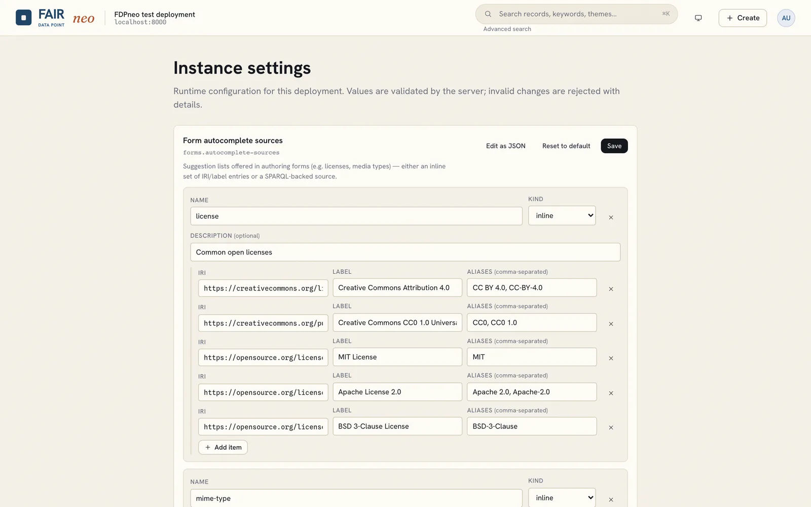
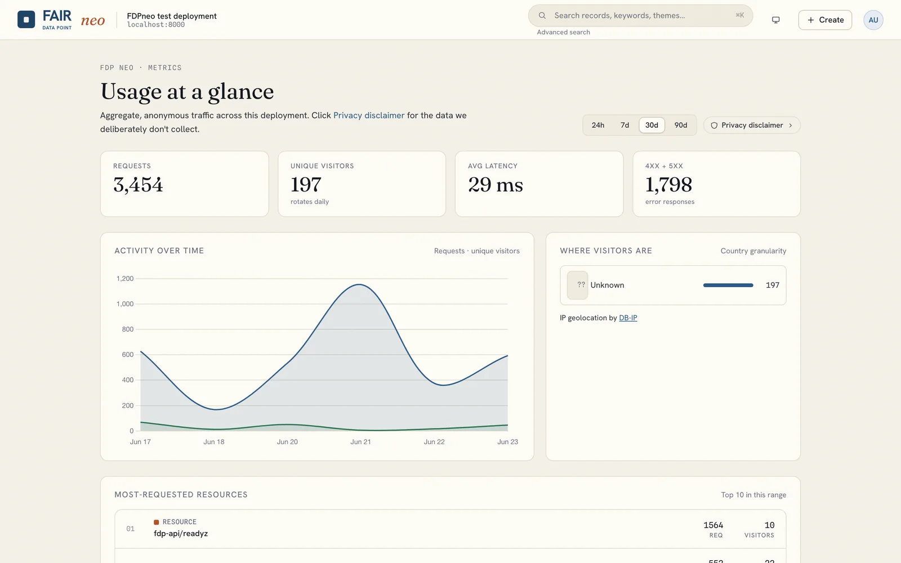
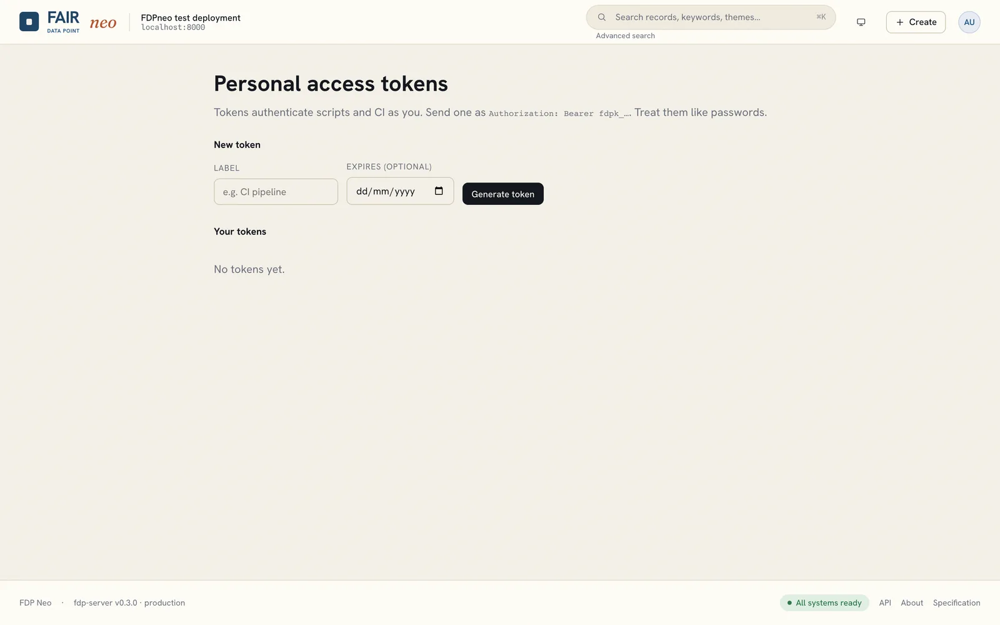

# Settings, metrics and maintenance

## Instance settings

Open **avatar, Settings** as an administrator.

Settings are per-key configuration values the server exposes: branding texts, search-filter configuration, form autocomplete sources, and others. Each is edited as JSON and validated server-side before it is stored.

Look and feel (colours, logo, favicon, organisation name) is configured on the client container instead, authored with the **Appearance** editor at `/appearance`; see [Configuration](../deployment/configuration.md).

## Metrics dashboard

Open **avatar, Metrics**. Stewards see metrics for the resources they own; administrators see the whole instance.

The dashboard shows a summary, time series, top resources and, when the server has a GeoIP database configured, the geography of visitors. The underlying metrics are anonymous by design: identifying data is dropped when a request is recorded, visitors are counted with a daily-rotated hash, query text is never stored and no analytics cookies are set. The dashboard can therefore never answer "what did user X do", only "how is this instance used".

## Access tokens

Open **avatar, Access tokens** as any signed-in user.

Create a personal access token to call the API from scripts and tools, and revoke it at any time. Copy the token when it is created: the server stores only a hash of it. See [API usage](../api/index.md).

## Factory reset

An administrator can **factory reset** the instance from the settings area (or with `POST /fdp-api/admin/reset`). This re-applies the deployment profile and restores schemas and policies to the profile baseline. It is destructive; back up first (see [Operations](../deployment/operations.md)).
