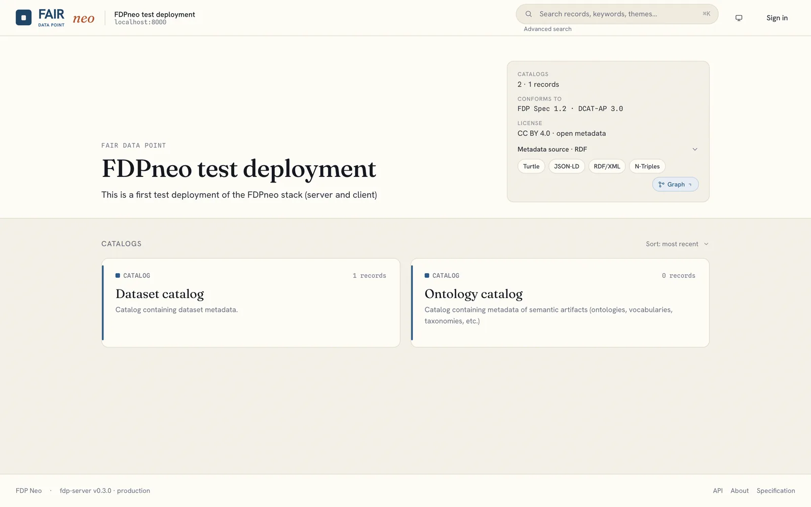
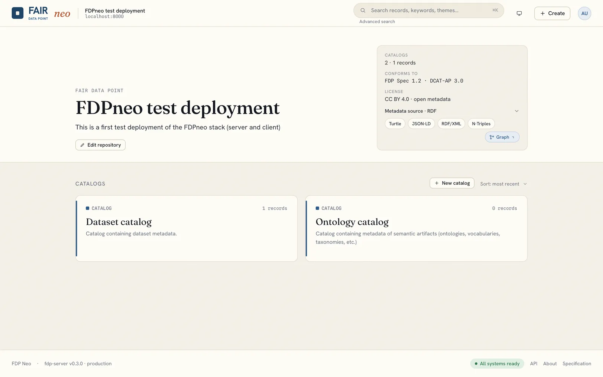
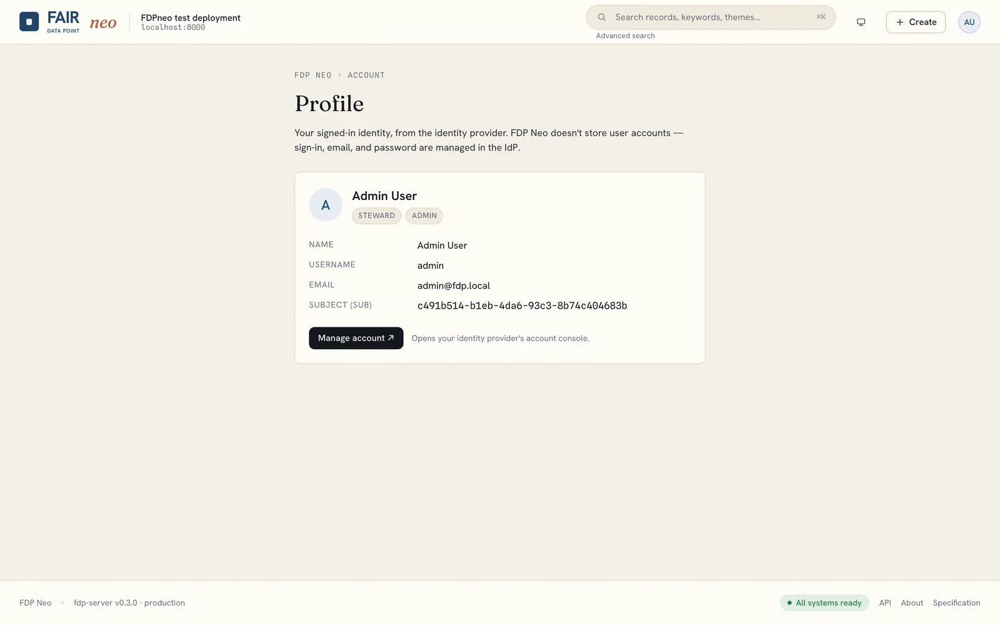
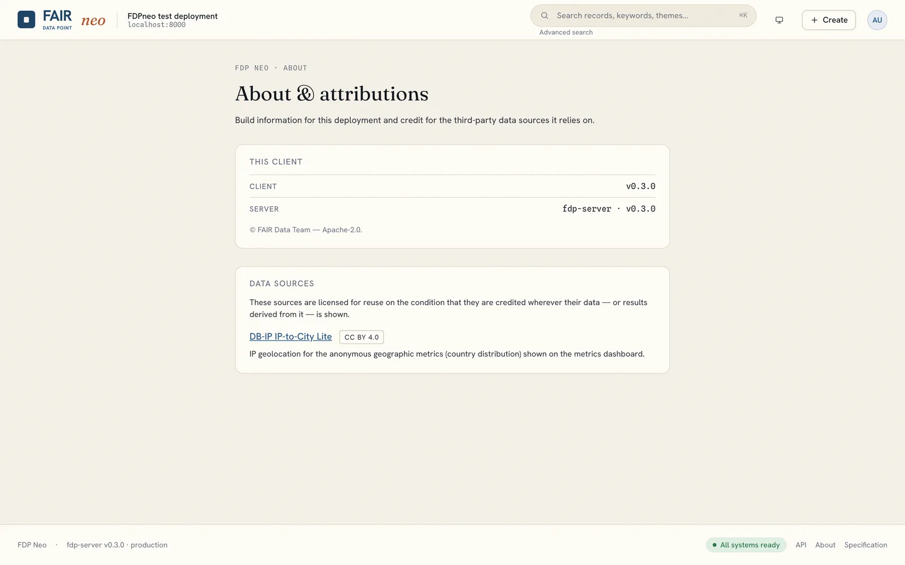

# Signing in and roles

Anyone can browse a FAIR Data Point without an account. Signing in unlocks what your role allows.

## Signing in

Click **Sign in** (or the avatar) in the top-right corner. You are redirected to the identity provider (Keycloak in the bundled stacks), authenticate there, and are sent back to the application. FDPneo never sees your password.

In the evaluation stack, sign in as `admin` / `admin` (administrator and steward), `alice` / `alice` (steward) or `bob` / `bob` (no role). In a production deployment, use the account your administrator created.

## What each role can do

| Role | Can |
|---|---|
| **Anonymous** (not signed in) | Browse and search **published** records, run SPARQL queries, view metrics. |
| **Steward** | All of the above, plus create, edit and delete their own records, manage publication state, and use the "My data" dashboard. |
| **Admin** | Everything, plus manage SHACL schemas, resource types, ODRL policies, licenses, instance settings, users, and factory reset. |

What you may do with a specific record is decided by the ODRL policy it references; see [Access policies](policies.md).

## Your profile

Your identity, roles and a **Manage account** link to the identity provider are under **avatar, Profile**. Passwords and e-mail addresses are changed in the identity provider's account console, not in FDPneo.

## Account menu

The avatar menu is where signed-in users find their pages. Stewards see **Dashboard** (My data) and **Access tokens**; administrators also see **Schemas**, **Resource types**, **Policies**, **Licenses**, **Users** (when the user-management façade is enabled), **Settings** and **Metrics**. The **About** page shows the server version, the applied profile and the enabled features.

