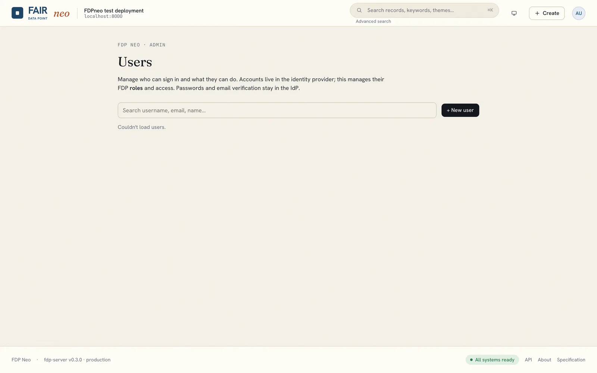

# Users

The **Users** page (avatar menu) lets administrators manage accounts without leaving FDPneo. It appears under the avatar menu only when the deployment has enabled the user-management façade (see [User management](../deployment/user-management.md)); both bundled stacks enable it.

- **Search** the directory and see each user's e-mail, roles and enabled status.
- **Edit** a user's roles (`steward`, `admin`) and enable or disable the account.
- **Invite** a new user. They receive an e-mail from the identity provider to set a password and verify their address; no password passes through FDPneo.
- **Delete** a user.

Guard rails prevent you from locking yourself out: you cannot delete yourself, remove your own `admin` role or disable your own account.

Everything on this page is performed in the identity provider on your behalf. Users created directly in the identity provider's console appear here as well.
